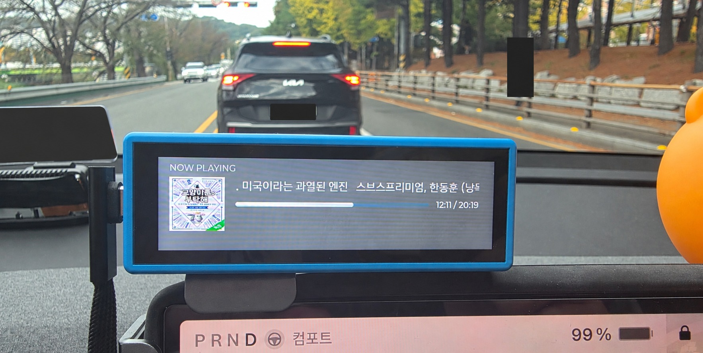
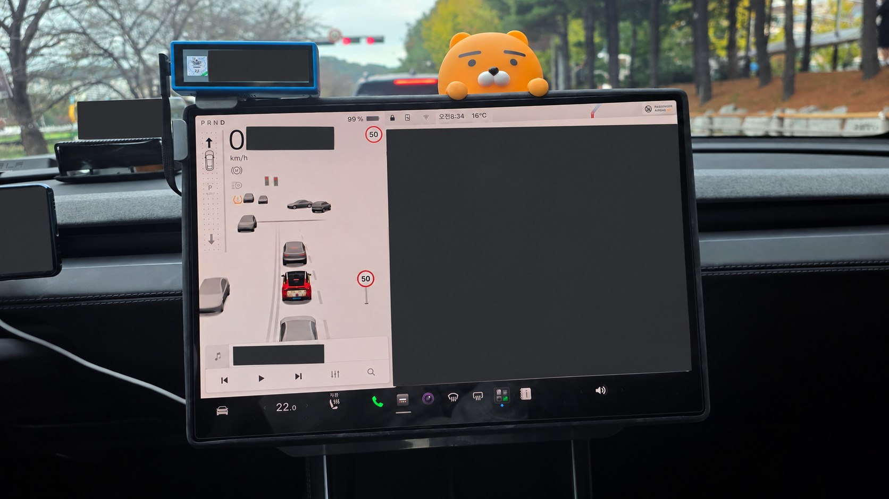
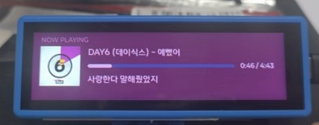

# DeckLink-Car-ESP32

차량에서 Android 미디어 세션을 ESP32-S3 소형 HMI에 표시하는 개인 제작 프로젝트입니다.
Plexamp·YouTube Music 등의 곡 제목, 아티스트, 앨범아트와 재생 상태를
BLE 또는 Wi-Fi로 전달하고, HMI의 재생 제어를 앱으로 돌려보냅니다.




### 가사 모드



곡 정보와 재생 진행률 아래에 가사를 표시하는 화면입니다.

차량 사진 두 장은 개인정보 가림을 위해 AI 편집한 공개용 사본입니다. 가사 모드 사진은 제공받은 사진을 사용했습니다. 번호판, 내비게이션 위치·경로,
기기 소유자 이름 등을 가리고 메타데이터를 제거했습니다.

## 사용 제품 · 보드 확인 필수

이 저장소는 **차량용 ESP32 버전**이며 사용 제품은 **Waveshare ESP32-S3-Touch-LCD-3.49**입니다.
사진 세 장은 모두 차량용 ESP32 프로젝트를 보여줍니다.

외형이 비슷한 **Waveshare RP2350-Touch-LCD-3.49(Pico 계열)** 제품도 있습니다.
Pico 프로젝트는 버튼을 눌러 사용하는 데크 용도의 별도 저장소로 관리하며,
이 저장소에 Pico 소스와 펌웨어를 포함하지 않습니다.
**구매 제품명과 보드 뒷면 MCU가 ESP32-S3인지 확인한 뒤 사용하세요.**
RP2350(Pico)와 ESP32-S3의 펌웨어는 호환되지 않습니다.

## 구성

- `android/`: DeckLink Android 앱. Android Studio에서 이 폴더를 엽니다.
- `firmware/`: Waveshare ESP32-S3-Touch-LCD-3.49용 ESP-IDF HMI 소스.

## Android 앱

JDK 17 이상, Android SDK 33, Gradle 9.3.1을 사용합니다. 최초 빌드는 의존성 다운로드가 필요합니다.
Android Studio에서 `android/`를 열고 Gradle 동기화 후 APK를 빌드합니다.
최소 Android 버전은 7.0(API 24)이며, 현재 target SDK는 33입니다.

1. 앱에서 **알림 접근 권한 열기**를 누르고 DeckLink의 접근을 허용합니다.
2. BLE 권한을 허용하고 보드를 켭니다. 기본 전송은 BLE입니다.
3. Wi-Fi를 사용할 경우 전송 방식을 바꾸고, 자동 탐색이 실패하면 보드 IP를 입력합니다.
4. 필요하면 배터리 최적화 제외를 허용합니다.

### Plex 설정 (선택)

앱의 **Plex 연동**에서 서버 기본 주소와 본인의 Plex 토큰을 입력하고 **Plex 설정 저장**을 누릅니다.
주소에는 경로·쿼리·토큰을 포함하지 않습니다. 예: `https://plex.example.com:32400`.
토큰 입력은 가려지고, 저장 후 입력란에서 지워집니다. 동일 서버에서 토큰 칸을 비우고 저장하면
기존 토큰을 유지하며, 서버를 바꿀 때는 토큰도 다시 입력해야 합니다.
**Plex 설정 삭제**는 저장된 주소와 토큰을 제거합니다.

설정은 Android Keystore 키로 암호화하여 백업 제외 영역에 저장합니다.
Plex 토큰은 요청 헤더로 보내며 자동 리디렉션은 따르지 않습니다.
HTTPS를 권장합니다. HTTP 주소는 암호화되지 않은 네트워크 통신입니다.
설정하지 않아도 기본 미디어 세션 표시와 다른 앨범아트 경로를 사용할 수 있습니다.

## ESP32-S3 HMI 펌웨어

기존 ESP-IDF v5.5.5 프로젝트를 바탕으로 합니다. ESP-IDF 환경에서:

```powershell
cd firmware
Copy-Item main/wifi_secret.h.example main/wifi_secret.h
# Wi-Fi를 사용하는 경우 로컬 wifi_secret.h에 SSID와 비밀번호를 입력합니다.
idf.py set-target esp32s3
idf.py build
idf.py -p COM3 flash monitor
```

`wifi_secret.h`와 빌드 결과는 Git에서 제외합니다. 생성된 펌웨어에는 Wi-Fi 자격증명이 포함될 수 있으므로
개인 설정으로 만든 바이너리를 공개하지 마세요. 외부 라이브러리는 Component Manager가 받습니다.

## 공개 범위

개인 Plex 주소·토큰, Wi-Fi 비밀번호, 개인 서버 설정을 제거했습니다.
이 저장소에는 원본 백업 압축파일, 로그, 캐시, 기존 APK·펌웨어 바이너리를 포함하지 않습니다.
기존 작업 폴더의 원본에는 개인 설정이 남아 있으므로 공개할 때 이 공개용 폴더만 사용하세요.
폰트와 보드 예제 등 타사 코드의 권리는 각 원저작자에게 있습니다.
